# Fitness Merchant

> Supplements and training gear in one modern, secure online store.

[](https://github.com/bojanpetkovski18/fitness-merchant/actions/workflows/ci.yml)
[](https://codespaces.new/bojanpetkovski18/fitness-merchant?quickstart=1)

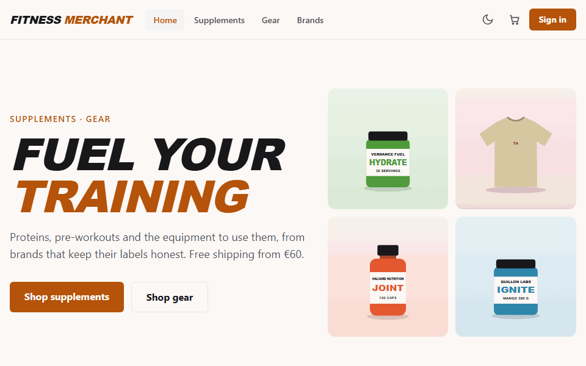

Fitness Merchant is a full-stack e-commerce application:
- **Customers** search and filter the catalog, keep a cart as guests, check out, track their orders and review products they bought.
- **Admins** manage products, categories, brands and images, move orders through their statuses, moderate reviews, export orders to CSV and read a sales dashboard.

It is a ground-up rebuild of my 2024 university thesis. The goal was production-quality code: a written specification, secure API design, tests at every level, Docker and CI.

- **Data:** entirely fictional. The store, brands, products, people and orders are invented, and all artwork is original SVG.
- **AI assistance:** this is an independent portfolio project built with AI assistance (Claude Code) under my direction and review. I wrote the specification and made the decisions, and I reviewed and merged every change.

## Try it

### In your browser: GitHub Codespaces

1. Click **Open in GitHub Codespaces** above. You need a GitHub account; it uses your free Codespaces hours.
2. Wait while the codespace builds and starts the app (several minutes the first time). The store opens in a new tab; if it doesn't, open the **Ports** tab and click the globe next to port 8080.
3. Sign in with a demo account (below). When you're done, stop or delete the codespace from <https://github.com/codespaces>.

### On your machine: Docker

You need Git and Docker with Compose v2 (Docker Desktop includes both).

```sh
git clone https://github.com/bojanpetkovski18/fitness-merchant.git
cd fitness-merchant
cp .env.example .env
docker compose up --build
```

On Windows, run `git config --global core.longpaths true` first, or clone into a short path such as `C:\src`: some migration file paths are long, and a deep folder pushes them past Windows' 260-character limit.

The first build takes a few minutes. When the log says the app is listening, open <http://localhost:8080>. The catalog is seeded on the first start.

- **Stop:** `Ctrl+C`, or `docker compose down`. Data stays in a Docker volume; `docker compose down -v` deletes it.
- **Another port:** set `APP_PORT` in `.env` if 8080 is taken.

Both setups serve plain http and turn off the HTTPS-only cookie rule (`Auth__RequireHttps=false` in `docker-compose.yml`). That is fine on your own machine or codespace; never run it that way on a public server.

### Demo accounts and payments

| Role | Email | Password |
|---|---|---|
| Admin | `admin@fitness-merchant.example` | `Change-Me-Admin-1` |
| Customer | `customer@fitness-merchant.example` | `Change-Me-Customer-1` |

These come from `.env` (`DEMO_*`); change them there if you like. Payments are fake: card `4242 4242 4242 4242` succeeds and `4000 0000 0000 0002` is declined. Use any future expiry and any CVC; nothing is charged.

## Guided tour

1. **Browse as a guest.** Open **Supplements**, search for "whey", filter by category, brand, price or in-stock only, and sort.
2. **Add to the cart** without an account. The cart lives in your browser; prices are always quoted by the server.
3. **Register or sign in.** Your guest cart is merged into your account's cart.
4. **Check out** with the fake card. Try the declined card too: the order is cancelled, the stock is returned and your cart is kept.
5. **Track the order** under **Account → Orders**.
6. **Sign in as the admin** (a separate browser window works well). On **Admin → Orders**, mark the order *Shipped* with a note. The customer sees the new status and the note.
7. **Explore the admin area:**
   - the dashboard (revenue, orders, average order value, revenue per day and top products for any date range, plus low stock);
   - products with image upload;
   - categories, brands and review moderation;
   - the CSV export.
8. **Toggle dark mode** and resize the window: every screen works from 320 px up and with the keyboard.

## Screenshots

| | |
|---|---|
| 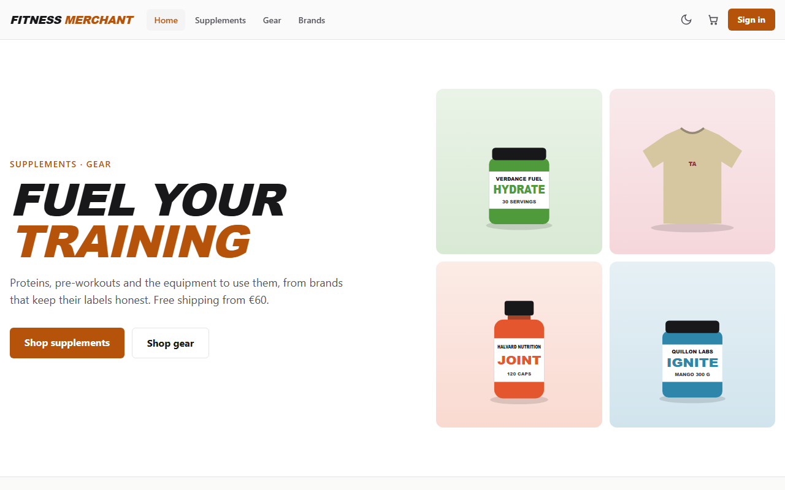 | 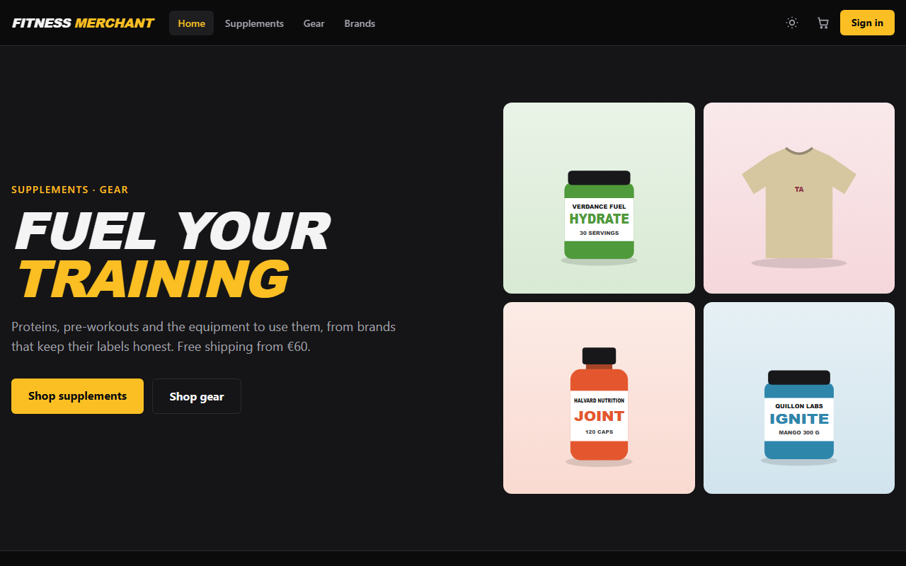 |
| 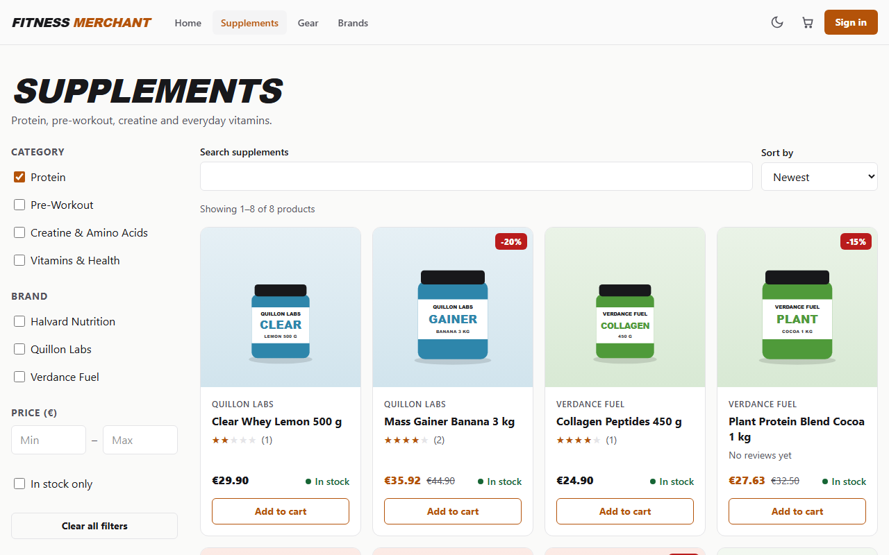 | 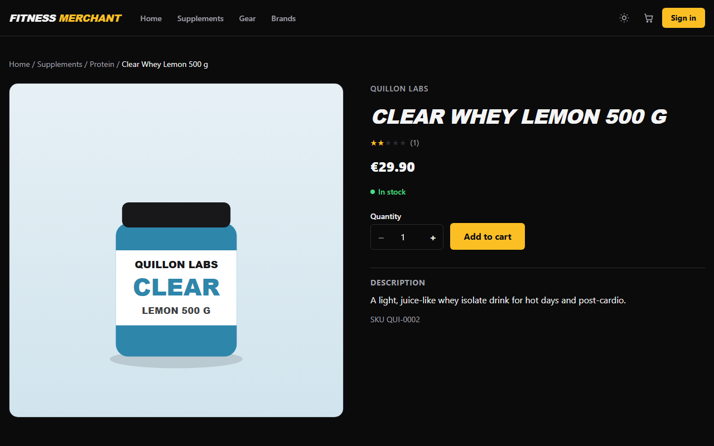 |
| 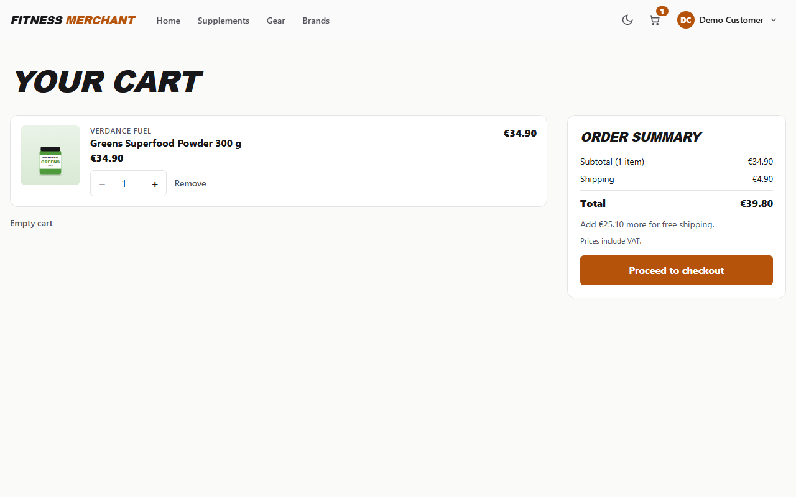 | 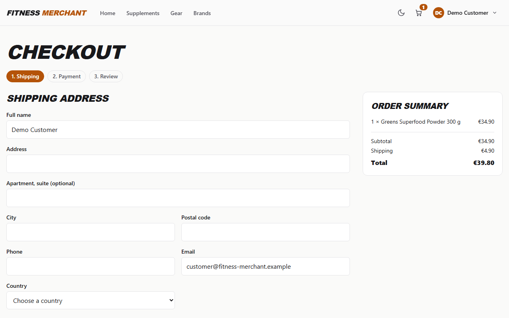 |
| 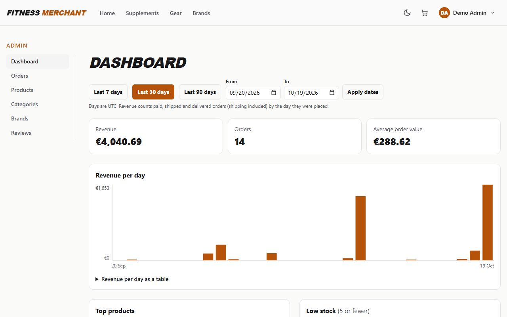 | 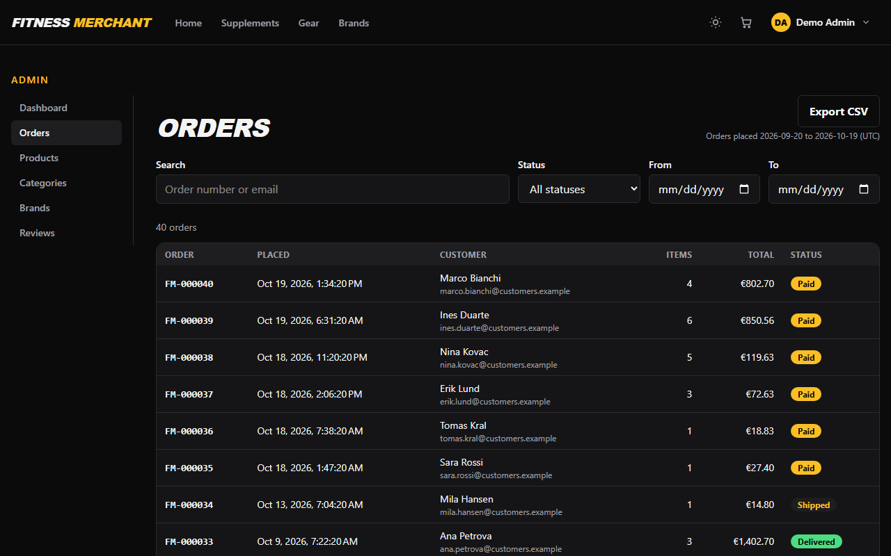 |

<p>
  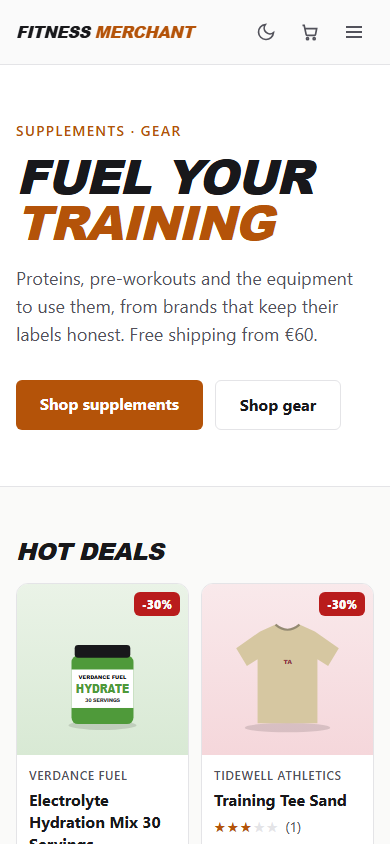
  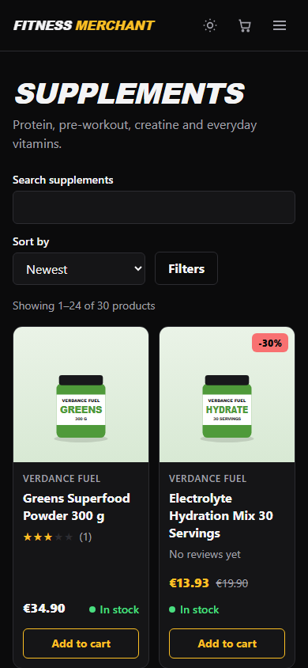
</p>

## Architecture

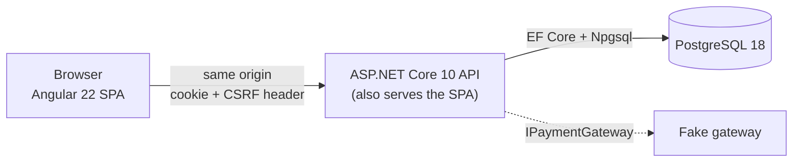

One container serves both the API and the built Angular app, so there is one origin: cookie authentication, CSRF protection and a strict Content-Security-Policy stay simple. Images and the cookie-signing keys live in PostgreSQL, so the container keeps no state.

The details (request flow, authentication and CSRF, checkout concurrency, payments, images and the data model) are in **[docs/ARCHITECTURE.md](docs/ARCHITECTURE.md)**.

## Stack, and why

| Part | Choice | Why |
|---|---|---|
| API | ASP.NET Core on .NET 10 LTS, Minimal APIs | Long-term support, fast, little ceremony; one handler class per command or query, no mediator |
| Data | PostgreSQL 18, EF Core 10 with Npgsql | Real transactions and row locks for stock, `numeric` money, strong free hosting options |
| Auth | ASP.NET Core Identity, cookie | HttpOnly cookie instead of tokens in JavaScript; same origin keeps it simple |
| Frontend | Angular 22, standalone components, zoneless, signals | Typed end to end, built-in forms, routing and HTTP |
| UI | Tailwind CSS v4, Angular CDK | Fast consistent styling; accessible primitives (dialogs, menus, focus) |
| Tests | xUnit v3, Testcontainers, Vitest, Playwright + axe | Integration tests against real PostgreSQL; accessibility checks in the E2E run |
| Delivery | Docker (chiseled, non-root), Compose, GitHub Actions | One command to run; every change is built and tested in CI |

## Quality

- **Tests:**
  - 383 API tests: unit tests, plus integration tests against real PostgreSQL in a container;
  - 113 Angular component tests;
  - one Playwright end-to-end journey against the production image, with an axe accessibility check on every page it visits.
- **CI** on every pull request: build and tests, the E2E journey, a full-history secret scan, and workflow and editorconfig lint.
- **Security:**
  - cookie auth with antiforgery tokens, and roles checked on the server;
  - "my" resources come only from the signed-in user;
  - parameterized SQL, rate limits and a strict CSP;
  - uploads checked by magic bytes and re-encoded;
  - CSV cells protected against formula injection.
- **Measured** (method, machine and date in [PROGRESS.md](PROGRESS.md#measured-results)):
  - 30 screens with 0 axe findings in both themes;
  - Lighthouse mobile performance 94–96 (home) and 92–93 (listing), accessibility 100;
  - catalog API p95 of 6.87 ms with 10 users;
  - a 272 MB production image.

## Developer setup

For development with hot reload: PostgreSQL in Docker, the API with `dotnet run`, and Angular with `npm start`.

```sh
cp .env.example .env
docker compose -f docker-compose.dev.yml up -d   # PostgreSQL on 127.0.0.1:5433
dotnet tool restore
dotnet run --project src/api/FitnessMerchant.Api # API on http://localhost:5080 (migrates and seeds)
cd src/web && npm ci && npm start                # SPA on http://localhost:4200
```

| Check | Command |
|---|---|
| API build (warnings are errors) | `dotnet build FitnessMerchant.slnx` |
| API tests (needs Docker) | `dotnet test --solution FitnessMerchant.slnx` |
| Web lint, format, tests, build | `cd src/web && npm run lint && npm run format:check && npm run test:ci && npm run build` |
| E2E (stack running) | `cd tests/e2e && npm ci && npx playwright install chromium && npx playwright test` |

The full list of verified commands is in [CLAUDE.md → Commands](CLAUDE.md#commands). The E2E test signs in as the demo admin from the same `.env`.

## Decisions and lessons from v1

Every significant choice is recorded with its reasons and trade-offs in **[DECISIONS.md](DECISIONS.md)**. The rebuild started from what went wrong in the 2024 version:

| v1 problem | v2 rule |
|---|---|
| Role taken from the registration body, so anyone could become Admin | Roles are never client-controlled |
| Carts and payments reachable by ID without an ownership check (IDOR) | "My" resources come from the signed-in user; admin resources sit under `/api/admin` |
| Money stored as `double` | `numeric(12,2)` / `decimal` |
| Signing key and connection string committed | Secrets come only from the environment |
| Every query loaded whole tables | Filtering, paging and aggregation run in SQL |
| Checkout ignored stock | One transaction with a conditional stock update: the last unit cannot be sold twice |
| No tests, CI or deployment | Tests at every level, CI, Docker, one-step demo |

Challenges worth reading about:
- the checkout race and idempotency (D024);
- per-request session invalidation (D025);
- upload hardening (D026);
- a strict CSP with Angular (D029);
- keeping the demo reset working on hosts that stop idle containers (D034).

## Limits

- **No public hosting** (D034). The demo runs on your machine or in your own codespace, at no cost to anyone else. The research for hosting it later is recorded in D034.
- **Payments are a fake gateway.** Stripe Checkout in test mode is planned but not built.
- **Single currency (EUR) and English only.**

## Licence

To be decided by the owner.
