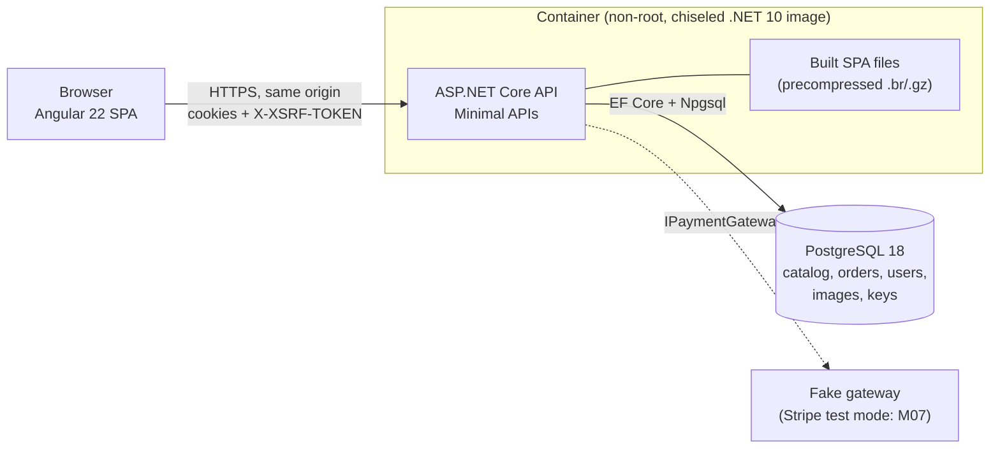
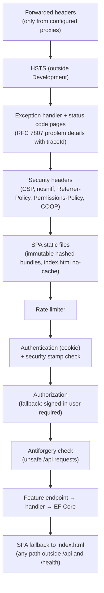
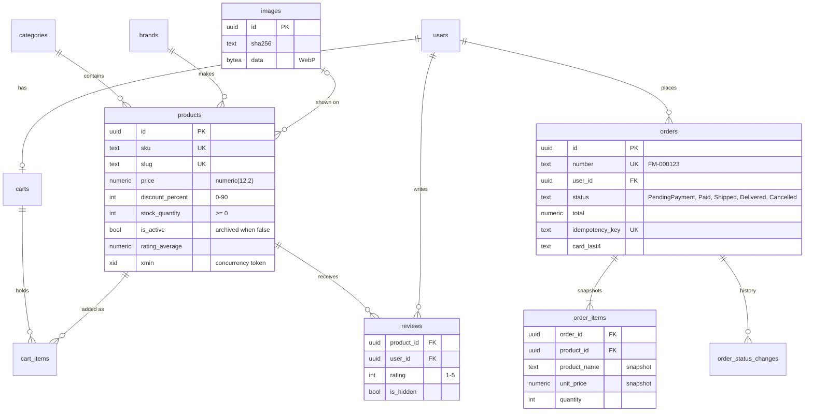
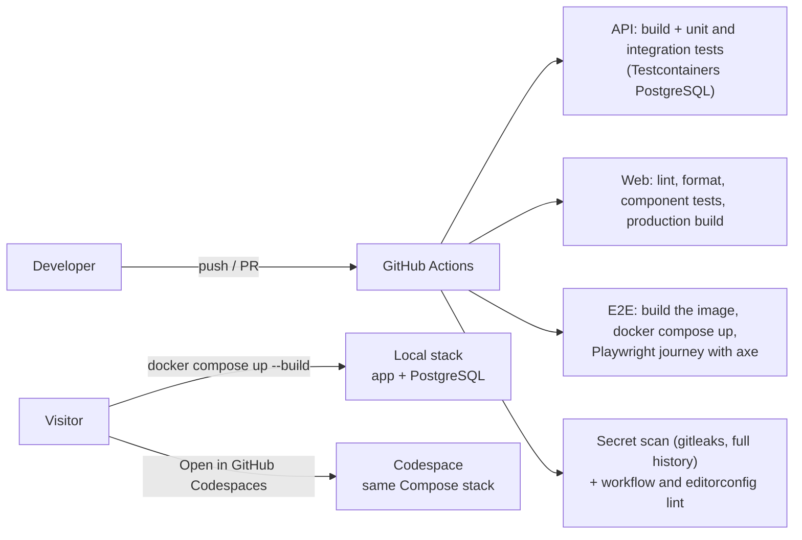

# Architecture

How Fitness Merchant is built, as of M14 (2026-10-19). The reasons behind each choice are in [DECISIONS.md](../DECISIONS.md); this page describes what the code does.

## Overview

One deployable: an ASP.NET Core API that also serves the built Angular app (D008). The browser talks to one origin, so cookies, CSRF protection and the Content-Security-Policy stay simple.

- **Backend:** `src/api/FitnessMerchant.Api`, organised by feature (`Features/<Feature>`: endpoints plus one handler class per command or query). `Domain/` holds entities and rules with no EF or HTTP types; `Infrastructure/` holds the DbContext, migrations, seeders, payments and image processing; `Common/` holds cross-cutting setup.
- **Frontend:** `src/web`, standalone components, zoneless change detection and signals. `core/` has the session and cart stores, interceptors, guards and layout; `features/` has one folder per area; `shared/` has presentational components.
- **Database:** PostgreSQL only. Images and data-protection keys are stored there too, so the container keeps no state (D010, D032).

## Request flow

Every request passes the same middleware, in this order (`Program.cs`):

- **Endpoints are thin:** they bind the request, apply authorization and rate-limit policies, and call a handler. Handlers own the logic and the queries.
- **Reads** use `AsNoTracking` and projections; filtering, sorting, paging and aggregation run in SQL. Sort columns come from fixed allow-lists.
- **Content-Security-Policy:** `script-src 'self'` and `style-src 'self'` with no `'unsafe-inline'`. The only inline styles allowed are three Angular CDK base style blocks, by hash (D036); the E2E journey fails on any violation.
- **Errors** are problem details with a `traceId`. Validation runs on the server; the client's checks only save a round trip.
- **Health:** `/health/live` (process) and `/health` (includes the database). The container's `HEALTHCHECK` runs the app itself with `--health-check`, because the chiseled image has no shell or curl.

## Authentication and CSRF

- **ASP.NET Core Identity with a cookie** (`fm_session`): HttpOnly, `SameSite=Strict`, HTTPS-only outside Development (`Auth:RequireHttps`, D032), 7 days sliding. No tokens are kept in JavaScript.
- **Security stamp checked on every request** (D025): a password change ends the user's other sessions immediately.
- **Authorization:** the fallback policy requires a signed-in user, so an endpoint is public only when it says `AllowAnonymous`. Admin endpoints sit under `/api/admin` with the `Admin` policy. "My" resources (cart, orders, account) come from the signed-in user, never from an ID in the URL, and another user's order answers `404`.
- **CSRF:** the API sets a readable `XSRF-TOKEN` cookie, and Angular echoes it as the `X-XSRF-TOKEN` header. A small middleware validates every unsafe `/api` request against the HttpOnly antiforgery cookie (`fm_af`), including sign-in and register (login CSRF). `SameSite=Strict` is a second layer.
- **Rate limits** per client IP: sign-in and register, checkout, cart quotes, uploads, CSV export, reviews and the demo reset. Behind a reverse proxy the client IP comes from `X-Forwarded-For`, but only from configured proxies and only for the configured number of hops (`ReverseProxy__*`).
- **Data-protection keys** (they sign the cookies) live in PostgreSQL, so sessions survive restarts and work on every instance. Optionally they are encrypted with a certificate kept outside the database (`DataProtection__CertificatePemPath`, D032 and D034).

## Cart

- **Guests** keep the cart in `localStorage`: product IDs and quantities only. Prices are always quoted by the server (`POST /api/cart/quote`).
- **Signed-in customers** have a server cart. Quantity changes are optimistic in the UI and rolled back with the server's reason on failure.
- **On sign-in** the guest cart is merged into the server cart: quantities are summed and capped at min(10, stock), and stale items are skipped. The guest copy is cleared only after the merge succeeds. A page load that finds guest items while already signed in merges them too, so an interrupted merge loses nothing (D032).

## Checkout and concurrency

`CheckoutHandler` turns the caller's cart into an order:

1. **Idempotency:** the client sends an `Idempotency-Key` header. A repeated key returns the existing order, and a unique index catches two simultaneous submits.
2. **Re-pricing:** the cart is priced again from current catalog data. If the total differs from the one the customer reviewed, the answer is `409 price-changed`.
3. **One transaction:** the handler takes an order number from a sequence, creates the order with price snapshots per line and takes the stock, then clears the cart.
   - Stock is taken with a single conditional `UPDATE … SET stock = stock - n WHERE id = … AND stock >= n`. Under READ COMMITTED a competing buyer blocks on the row lock and re-checks the condition, so the last unit can never be sold twice (D024; a `stock >= 0` check constraint is a second net).
4. **Payment outside the transaction:** an external call must not hold row locks. On a decline or gateway error, a compensating transaction cancels the order, returns the stock and puts the items back in the cart.

Other concurrency points:
- Products and orders carry PostgreSQL `xmin` as a concurrency token, so two admins editing at once get a conflict instead of a lost update.
- Order status changes follow a fixed transition table; cancelling restocks.
- A new review recalculates the product's rating under a product row lock.
- The demo reset runs under a PostgreSQL advisory lock.

## Payments

- `IPaymentGateway` has one implementation today: a deterministic **fake gateway** for local runs, tests and E2E. Card `4242 4242 4242 4242` succeeds, `4000 0000 0000 0002` is declined, and nothing leaves the process. Card numbers are never stored or logged; only the brand and the last four digits are kept.
- **Stripe Checkout in test mode** (hosted payment page plus a signature-verified, idempotent webhook) is planned as M07 and is not built yet.

## Images

- **Upload** (admin only, rate-limited): the format is read from the magic bytes, never from the file name or declared type. Files are at most 1 MB and 4000×4000 px; dimensions are read from the header before decoding, so a small file cannot expand into a huge bitmap.
- **Re-encoding:** every accepted image is decoded and re-encoded to WebP (SkiaSharp, quality 85). This drops EXIF, XMP and ICC metadata (camera, GPS); the EXIF orientation is applied first.
- **Storage:** images live in PostgreSQL. The demo needs fewer than 200 images, and the container keeps no files (D010).
- **Serving:** `GET /api/images/{id}`. Image bytes never change for an ID, so responses are cached for a year as immutable, with the content hash as a strong ETag.
- **Seed artwork** is original SVG, generated in code (`Infrastructure/Seed/Artwork.cs`).

## Data model

Also in the schema:
- the Identity tables (`users`, `roles`, `user_roles` and others, renamed to snake_case);
- `data_protection_keys`, the cookie-signing key ring;
- `demo_state`, the time of the last demo reset.

Money is `numeric(12,2)` and `decimal` everywhere.

## Demo mode

`DEMO_MODE=true` shows a banner and enables `POST /api/admin/demo/reset`, which restores the seed data in one transaction. The reset keeps the two demo accounts and removes everything visitors created (D030).

The reset also runs on a schedule (`DEMO_RESET_INTERVAL_HOURS`, default 6). The last reset time is stored in the database, and each instance checks at startup and every 10 minutes, so the schedule also works on hosts that stop idle containers (D034).

## Running and delivery

- **Image:** a multi-stage `Dockerfile`. A Node stage builds the SPA, a .NET SDK stage publishes the API, and the runtime is the chiseled ASP.NET image running as a non-root user. Every base is pinned by tag and digest.
- **Compose:** `docker-compose.yml` runs PostgreSQL and the app. Migrations and the seed run on start; the app listens on `127.0.0.1:8080`.
- **No public hosting** (D034): the demo runs locally or in the visitor's own GitHub Codespace (`.devcontainer/`). The hosting research and the code prepared for a scale-to-zero host are recorded in D034.
